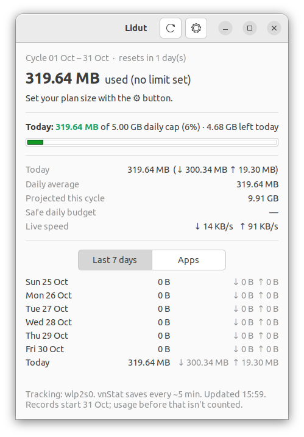
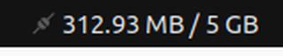

# Lidut — Linux Data Usage Tracker

**Know where your data goes before your bundle runs out.**

Lidut (**Li**nux **D**ata **U**sage **T**racker) is a small Linux desktop app for people on limited internet plans: mobile data
bundles, capped home broadband, or tethering from your phone. It sits in your top bar,
shows how much you've used today against your own cap, warns you before you run out, and
(optionally) shows which apps used the data.

<p align="center">
  <br>
  
</p>

## Features

- **Lives in the top bar.** Shows today's usage at a glance, for example `312 MB / 5 GB`.
  Click it for a quick menu; the icon turns into a warning sign as you near your limit.
- **Daily cap.** Set how much you want to use per day and watch a progress bar that goes
  green → amber → red.
- **Monthly plan.** Track usage across your billing cycle (any reset day), with data left,
  daily average, a projection for the whole cycle and a safe daily budget.
- **Warnings.** Desktop notifications at 80% (adjustable) and 100% of your daily cap and plan.
- **Per-app usage (optional).** See which apps used the most data today or this cycle.
- **History.** The last 7 days at a glance, and live download/upload speed.
- **Counts only what costs you money.** Tracks Wi-Fi, Ethernet, mobile modems and USB
  tethering, and ignores Docker, LXC, VPN bridges and other virtual interfaces.
- **Lightweight.** A single Python file over [vnStat](https://humdi.net/vnstat/), which does
  the counting in the background and keeps totals across reboots.

## Requirements

- Linux with GNOME (tested on **Ubuntu 22.04**); other desktops work as a normal window
- Python 3.8+ with PyGObject (GTK 3)
- `vnstat`, `libnotify-bin`, and AppIndicator support for the top-bar icon
- `nethogs`, only if you want per-app usage

`install.sh` installs any missing packages with `apt`. See [requirements.txt](requirements.txt)
for details.

## Install

```bash
git clone https://github.com/michsethowusu/lidut.git
cd lidut
./install.sh
```

Lidut starts in your top bar right away, appears in your app menu, and starts
automatically every time you log in.

> vnStat only counts from the moment it's installed, so the first day will show only part of
> the day's usage.

### Per-app usage (optional)

vnStat counts totals per connection, not per app. To see which apps use your data:

```bash
sudo ./install-app-tracking.sh
```

This installs [NetHogs](https://github.com/raboof/nethogs) and a small background service,
`lidut-apps`, that records each app's downloads and uploads per day. It runs as root because
working out which program owns network traffic needs admin rights. Open the **Apps** tab in
the window to see the results.

## Using Lidut

| What you want | How |
|---|---|
| Open the window | Click the top-bar label → **Open Lidut** (or middle-click it), or launch Lidut from the app menu |
| Set your daily cap or monthly plan | Click ⚙ in the window |
| See which apps used data | **Apps** tab → choose *Today* or *This cycle* |
| Hide the window | Close it; Lidut keeps running in the top bar |
| Quit completely | Top-bar menu → **Quit** |

### Settings

| Setting | Meaning |
|---|---|
| Monthly plan (GB) | Size of your monthly plan; `0` means no limit |
| Daily cap (GB) | How much you want to use per day; `0` means no limit |
| Plan resets on day | Day of the month your plan renews (clamped for short months) |
| Warn me at (%) | When to show the first warning |

Settings are saved in `~/.config/lidut/config.json`.

## How it works

```
 network card ──► vnStat daemon ──► vnstat --json ──┐
                                                    ├──► Lidut (GTK window + top-bar icon)
 network card ──► NetHogs ──► lidut-collector ────┘
                  (optional)   /var/lib/lidut/apps.json
```

- **vnStat** records totals per interface. Lidut reads them every minute and adds up the
  real (physical) interfaces.
- **lidut-collector** (optional) runs NetHogs in trace mode, turns its per-process
  counters into per-app daily totals, and keeps 62 days of history.

### Accuracy notes

- vnStat writes to disk about every 5 minutes, so totals can be a few minutes behind.
  Live speed updates every 2 seconds.
- Your provider's meter may differ slightly: it can count protocol overhead differently or
  round up per session.
- App totals usually add up to a bit less than the overall total. Traffic NetHogs can't tie to
  a program (DNS, some system traffic) goes under *Other*, and all browser tabs count as the
  browser.

## Tips for saving data on Ubuntu

- Mark your connection as metered: **Settings → Wi-Fi → ⚙ next to your network → Details →
  Metered connection**. Ubuntu then holds back automatic updates and other background downloads.
- Use the **Apps** tab to catch background hogs: cloud sync, Snap refreshes, Docker pulls,
  browser auto-updates.
- Hold back snap refreshes: `sudo snap refresh --hold=72h`.

## Uninstall

```bash
./uninstall.sh            # keeps your settings
./uninstall.sh --purge    # also deletes settings and per-app history
```

vnStat itself is left installed.

## Project layout

| File | Purpose |
|---|---|
| `lidut` | The app (GTK window, top-bar icon, notifications) |
| `lidut-collector` | Optional per-app collector (runs as a root systemd service) |
| `install.sh` / `uninstall.sh` | Install or remove for the current user |
| `install-app-tracking.sh` | Install the optional per-app service |
| `requirements.txt` | Python and system dependencies |

## License

[MIT](LICENSE) © 2026 Mich-Seth Owusu
